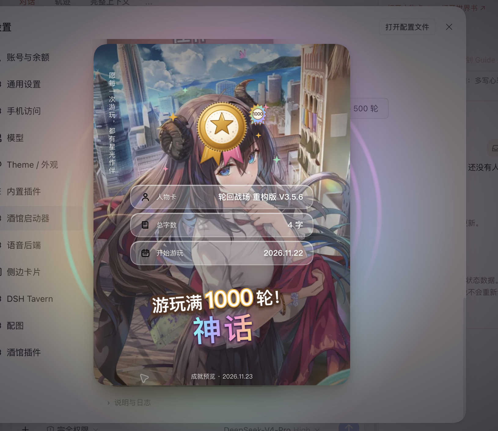

# DSH Tavern Achievements · 酒馆游玩成就

在 DSH Tavern 中首次达成游玩成就时，屏幕中央会出现一张游玩成就卡。解锁后可在「设置 → 酒馆启动器 → 成就库」回看成就卡牌。

| 轮数 | 成就 |
| --- | --- |
| 50 | 佳作 |
| 100 | 名篇 |
| 300 | 传奇 |
| 500 | 史诗 |
| 1000 | 神话 |

成就在游玩对话结算时解锁，每档在同一酒馆档案中只颁发一次。成就库只展示已正式解锁的卡牌。

## 安装

插件名为 `dsh-tavern-achievements`。新版 DSH Tavern 随酒馆更新内置插件，可在「设置 → 酒馆插件」停用。升级酒馆时会接管旧名 `dsh-tavern-adventure-medal` 的独立安装，保留已有成就和停用状态。

需要手动安装时，可在新版酒馆上传 [dsh-tavern-achievements.zip](./dsh-tavern-achievements.zip) 并按提示重启。旧版酒馆对应的安装包见 [v2.9.2](https://github.com/flizzywine/dsh-tavern-achievements/releases/tag/v2.9.2)。

## 酒馆发行副本

酒馆发行版将本仓库的 `dsh-tavern-achievements/` 放入 `tavern-plugin/packages/`。共用卡面的 `launcher-assets/` 同步到 `tavern-plugin/packages/dsh-tavern/assets/`，因此切换回原版 DSH 后，酒馆启动器仍能展示已解锁的卡牌。

本项目基于 [SilverLark257 的原版奖牌插件](https://github.com/SilverLark257/dsh-tavern-adventure-medal)。许可证见 [MIT License](./dsh-tavern-achievements/LICENSE)。
